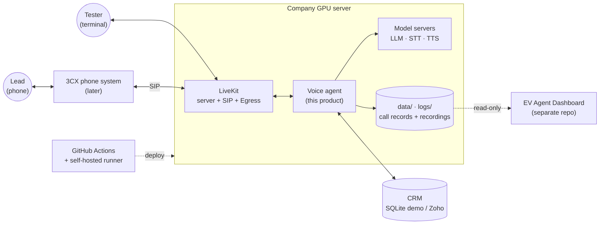
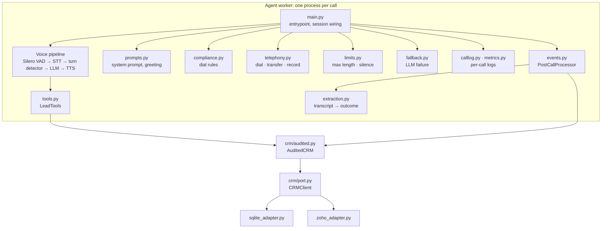
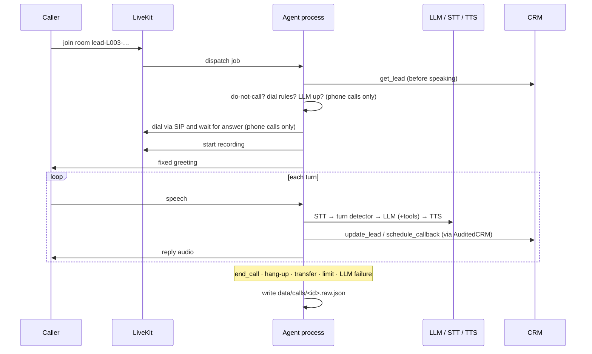
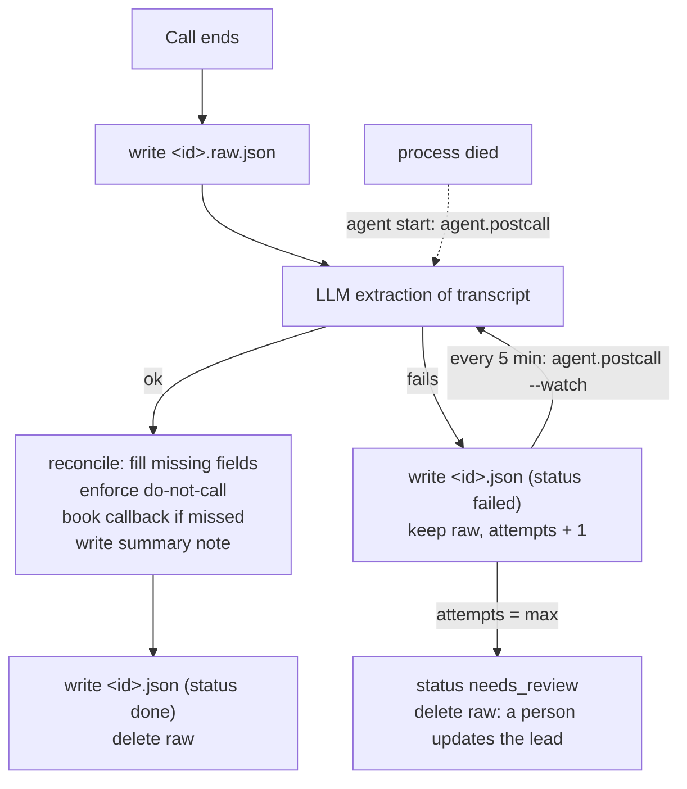
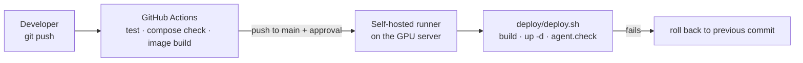

# Software Architecture Document (SAD)

**Product:** EV AI Voice Agent: real-estate lead qualification
**Version:** 0.1 (in-company test version) · **Date:** 2026-10-20 · **Status:** Draft
**Companion document:** [SRS.md](SRS.md) (what it must do). Shorter overview: [architecture.md](architecture.md). Logged fields: [call-record.md](call-record.md).

---

## 1. Purpose and scope
This document describes how the voice agent is built: the parts, how they talk to each other, where data lives, how it is deployed, and why the main choices were made. It matches the code on branch `feature/prod-ready`.

## 2. Architectural drivers

| Driver | Consequence |
|---|---|
| Cost: at about 3,000 calls a day, paid cloud AI APIs would cost far more than our own GPU server | Self-hosted LLM, STT, TTS, media server; no cloud AI APIs |
| Natural-sounding phone conversation | Streaming pipeline, local VAD and turn detector, preemptive generation, thinking off, short replies |
| About 2,800 calls a day on one GPU server now , in AWS server later | One process per call, vLLM batching and prefix caching, a load-test tool |
| Never lose a call result | Raw record first, post-call retry, atomic writes |
| CRM will change (demo now, Zoho later) | Ports and adapters; every write audited |
| A separate dashboard tracks calls | The agent writes plain files in a documented format; the dashboard only reads them |
| Test on laptops, run on a server | OpenAI-compatible APIs everywhere; Ollama or vLLM by `.env` |

Constraints: English only, 24/7, SQLite demo CRM, placeholder prompts (see SRS 2.4).

## 3. System context



## 4. Container view (what runs on the server)

All containers use host networking and are defined in `services/docker-compose.yml`.

| Container | Technology | Responsibility | Port |
|---|---|---|---|
| `livekit` | LiveKit server | Rooms, WebRTC audio, signalling | 7880, 7881/tcp, 7882/udp |
| `redis` | Redis (localhost only) | LiveKit ↔ Egress (and later SIP) messaging | 6379 |
| `egress` | LiveKit Egress | Records both sides of each call to `data/recordings/<room>.ogg` | n/a |
| `vllm` | vLLM, Qwen3.5-9B | Chat with tool calls and JSON output; thinking off; prefix caching | 8000 |
| `stt` | faster-whisper large-v3-turbo (or Parakeet on CPU) | Speech to text | 8001 |
| `tts` | Kokoro | Text to speech | 8880 |
| `agent` | Python, LiveKit Agents 1.8 | The worker: conversation, tools, CRM, post-call work | n/a |

Variants: `docker-compose.ollama.yml` (use the server's Ollama instead of vLLM), `docker-compose.cpu.yml` (no GPU, tests only), `docker-compose.local.yml` (laptop).

## 5. Component view of the agent (`agent/`, `crm/`)



| Module | Responsibility |
|---|---|
| `agent/main.py` | Worker entrypoint. Resolves the lead, runs the dial checks, builds the session, wires events, publishes the end-of-call event. |
| `agent/prompts.py` | System prompt (filled from the CRM lead) and the fixed greeting. Versioned by a hash saved with every call. |
| `agent/tools.py` | Tool logic (update lead, callback, do-not-call, transfer) with no LiveKit dependency. The lead id is bound at construction. |
| `agent/compliance.py` | Dial rules: do-not-call, blocked statuses, per-day and per-week limits, optional hours. Writes blocked dials. |
| `agent/telephony.py`, `agent/dial.py` | SIP dial through the 3CX trunk with line-result classification, SIP transfer, Egress recording; CLI to start a call. |
| `agent/limits.py` | Maximum call length and silent-caller handling. |
| `agent/fallback.py` | Fixed apology, callback and note when the LLM fails mid-call. |
| `agent/events.py` | `CallEnded` event, `PostCallProcessor` (extract, reconcile, write CRM, callback booking, retry), in-process bus, `process_pending`. |
| `agent/extraction.py` | Post-call LLM call returning a validated `CallOutcome`; `reconcile` merges it with the live values. |
| `agent/postcall.py` | CLI/loop that finishes or retries unfinished calls. |
| `agent/calllog.py`, `metrics.py`, `logging_setup.py` | Per-call timeline, LLM request log, CRM change log, latency and token metrics, JSON service logs. |
| `agent/check.py` | Health check of LLM, STT, TTS, LiveKit, Redis; writes `data/health.json`; call-latency report. |
| `agent/config.py` | All settings from the environment; LLM backend detection; thinking-off switches; warm-up. |
| `demo/` | The demo website: a small API (leads, LiveKit token, call record) and one page. Uses the demo CRM only. |
| `crm/port.py` | `CRMClient` protocol and models (`Lead`, `LeadUpdate`, enums). |
| `crm/audited.py` | Wraps any adapter; reports every write with before and after. |
| `crm/sqlite_adapter.py`, `crm/zoho_adapter.py` | The two implementations. |
| `services/stt_server.py` | OpenAI-compatible STT service. |
| `evals/`, `loadtest/` | CRM-extraction and speech accuracy evals; calls-per-GPU load test with simulated callers. |

## 6. Runtime views

### 6.1 One call



### 6.2 After the call, and retry



Reconcile rule: a field the agent already saved during the call is kept; extraction only fills empty fields. A retry after a failed extraction writes nothing twice, because nothing was written before the failure.

### 6.3 Failure handling

| Failure | Behaviour |
|---|---|
| LLM down before a phone dial | Dial blocked (`llm_down`), logged |
| LLM fails mid-call | Fixed apology, callback booked, note added, call ends (`ended_by = llm_failure`) |
| TTS down at the same time | The apology is skipped; the callback and note still happen |
| Lead hangs up | Session closes; post-call work starts at once |
| Agent process dies | Raw file remains; finished at next agent start |
| Post-call LLM or CRM fails | Retried every 5 minutes up to 5 times, then `needs_review` |
| Phone not answered | Line result saved (busy, no answer…); a CRM note records the attempt |
| Call too long / caller silent | Goodbye and hang-up (`max_duration` / `silence`) |
| Bad deploy | Health check fails; automatic rollback to the previous commit |

## 7. Data view

### 7.1 Where data lives
No application database yet. State is plain files, which keeps the dashboard simple and every write inspectable.

```
data/crm.db                               demo CRM (SQLite, leads as JSON)
data/calls/<id>.json                      final call record (read by the dashboard)
data/calls/<id>.raw.json                  call before / during post-call work, kept while a retry is pending
data/calls/<id>/events.jsonl              timeline of the call
data/calls/<id>/llm.jsonl                 every LLM request and reply
data/calls/<id>/crm_changes.jsonl         every CRM write: before → after
data/calls/<id>/agent.log, recording.ogg
data/recordings/<room>.ogg                Egress output
data/blocked/<date>.jsonl                 dials stopped by the calling rules
data/health.json                          service check, rewritten every minute
logs/<service>/<date>.jsonl               JSON service logs tagged with call_id
```

### 7.2 CRM model (`crm/port.py`)
`Lead`: id, name, phone, email, project_interest, status, budget, preferred_area, property_type, timeline, interest_level, callback_at, do_not_call, notes.
`LeadStatus`: new, contacted, interested, qualified, not_interested, callback, do_not_call, wrong_number.
The agent may change only the fields in `LeadUpdate`.

### 7.3 Status mapping to Zoho (draft)
`new → Not Contacted`, `contacted → Contacted`, `interested/qualified → Pre-Qualified`, `not_interested → Lost Lead`, `callback → Contact in Future`, `do_not_call → Not Qualified`, `wrong_number → Junk Lead`. This is a draft: it is lossy in both directions and will be replaced when the sales team provides the real values.

### 7.4 Call record
Defined field by field in [call-record.md](call-record.md). Key parts: transcript, classification and extraction, tool calls, CRM changes, line result, recording, per-turn latency and tokens, models and versions, settings, errors, `post_call_status`, `post_call_attempts`, `callback`.

## 8. Deployment view



- **One server, one `.env`.** `DEPLOY_DIR` (default `/opt/ev-voice-agent`) holds `.env`, `data/` and `logs/`.
- **Graceful deploys.** The old agent has `stop_grace_period: 10m`, so running calls finish.
- **Start-up of the agent container:** finish left-over post-call work; start the retry loop (every 5 minutes) and the health writer (every minute); then run the worker.
- **GPU memory:** vLLM takes `VLLM_GPU_UTIL` (0.55), STT and TTS the rest. 24 GB cards use FP8.
- **Secrets** stay in the server's `.env`; GitHub holds only non-secret variables.

## 9. Cross-cutting concerns

| Concern | Approach |
|---|---|
| **Configuration** | Environment variables read into one frozen `Settings` object; `.env.example` documents each one. |
| **Logging** | JSON lines per service, each tagged with `call_id`, `lead_id`, `room`; a log folder per call; full LLM messages on by default (`LOG_LLM_MESSAGES`). |
| **Observability** | Per-turn STT/LLM/TTS timing and token counts in every call record; `agent.check`; `health.json`; the dashboard. |
| **Error handling** | Pipeline errors are classified by stage (stt, llm, tts, vad, session, crm, post_call) and stored with the call. Recording and logging failures never drop a call. |
| **Security** | Self-hosted models; secrets in `.env`; phone numbers masked in logs; the lead id is bound to the tools. Model servers rely on firewalling (no authentication). |
| **Data handling** | Transcripts, recordings and LLM logs are call data that only admins see (on the dashboard). Retention and consent rules are not defined yet. Privacy was not a design driver: self-hosting was chosen for cost. |
| **Testing** | Unit and wiring tests with a fake LLM (CI); opt-in real-LLM scenario tests; extraction and speech evals; a load test with simulated callers. |

## 10. Architecture decisions

| # | Decision | Why | Consequence |
|---|---|---|---|
| D1 | Self-host LLM, STT, TTS and LiveKit | Cheaper than cloud AI APIs at this call volume (a cost decision, not a privacy one) | Needs a GPU server and its upkeep |
| D2 | Cascaded pipeline (STT → LLM → TTS), not a speech-to-speech model | Any LLM can be used; text transcript is exact for CRM and logs; each part can be swapped | Higher latency than end-to-end models; tuned with preemptive generation and short replies |
| D3 | vLLM in production, Ollama for tests, same OpenAI API | vLLM batches many calls; Ollama is easy on laptops | Small code paths for each backend's "thinking off" switch |
| D4 | One process per call | Isolation; post-call work runs in parallel with no queue | Memory per call (VAD and turn-detector models) limits concurrency |
| D5 | No Celery | Post-call work is 1 to 2 seconds and already parallel; a queue adds parts to run | Retry is a file-based loop (`agent.postcall`), not a broker |
| D6 | Redis kept | LiveKit needs it for Egress and SIP | The agent itself does not use it |
| D7 | CRM behind a port; every write audited | Demo now, Zoho later; full history of what the agent changed | A new CRM means one new adapter |
| D8 | Plain files for call state and records | Simple, inspectable, dashboard reads them directly | Call limits and listings get slower as files grow; PostgreSQL index planned |
| D9 | Fixed greeting text (no LLM) | Starts at once and the wording is always right | Greeting changes need a code change |
| D10 | Raw record first, then post-call work with retry | A crash or outage must not lose a call | Two files per pending call; a `needs_review` state people must watch |
| D11 | Post-call check keeps the live value on disagreement | The caller confirmed it live | A wrong live value is not corrected automatically; disagreements are logged |
| D12 | Local turn detector and VAD interruption | LiveKit's cloud versions are paid per use; the local ones cost nothing per call | English-only turn model |

## 11. Quality attributes

| Attribute | How it is addressed | Gap |
|---|---|---|
| Performance | Streaming, preemptive TTS, thinking off, prefix caching; latency measured per turn | No agreed target; load-test results not yet recorded |
| Scalability | `AGENT_IDLE_PROCESSES`, `VLLM_MAX_NUM_SEQS` (48), load test | One server, no failover |
| Availability | Auto-restart, health checks, rollback, graceful deploy | Single point of failure; no alerting |
| Data integrity | Atomic writes, raw-first, audit of every CRM write | Zoho adapter does not detect errors returned in a successful response yet |
| Maintainability | Ports and adapters, small modules, tests, versions stored per call | Prompts and status mapping are provisional |
| Security | Self-hosted, masked numbers | Unauthenticated model servers; no retention policy; data folder inside OneDrive |

## 12. Known gaps and risks

1. **No campaign runner.** Nothing chooses leads or places scheduled callbacks; calls start by hand (`agent.dial`).
2. **Duplicate dials possible.** A call only counts toward the limits when it ends, so two dials at once for one lead both pass.
3. **Zoho adapter.** Not tested on the real CRM; errors inside successful responses are missed; each call process refreshes its own token (rate-limit risk at volume); several API calls per write; lossy status mapping.
4. **No voicemail detection** and **no phone-number normalization** (needed before real dialing).
5. **English only, by design.** Arabic is not planned.
6. **Compliance.** No AI disclosure in the greeting, no registry check, no retention policy.
7. **Operations.** No alerting; call data never cleaned up; deprecated `livekit.plugins.turn_detector` to be replaced.

## 13. Evolution

| Step | Content |
|---|---|
| Now | Sales scenarios into the prompts; real Zoho connection and status mapping |
| Next | Zoho adapter hardening; phone-number normalization; voicemail detection; 3CX trunk |
| Then | Campaign runner with callbacks and retries; PostgreSQL index for calls and limits; alerting |
| Later | Warm transfer with summary; several GPU servers |
