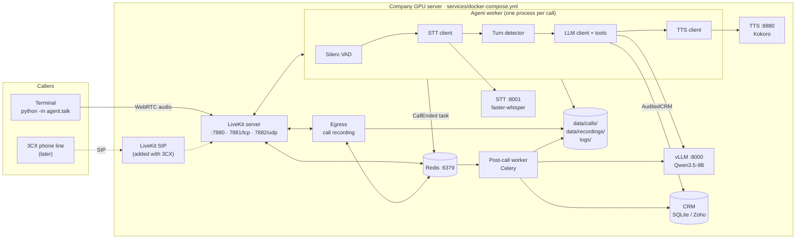

# Architecture

A self-hosted AI voice agent that phones real-estate leads, qualifies them, and updates the CRM.
Everything runs on the company GPU server. Nothing goes to a cloud API.

## The picture



## What each part does

| Part | Runs as | Job |
|---|---|---|
| **LiveKit server** | `livekit` container | Rooms and real-time audio (WebRTC). Every call is one room. The terminal client joins today; the 3CX line will join through LiveKit SIP later. |
| **Agent worker** | `agent` container, `agent/main.py` | LiveKit sends it each new room. It loads the lead from the CRM, then runs the voice pipeline: VAD → STT → turn detector → LLM with tools → TTS. Each call gets its own process. |
| **vLLM** | `vllm` container | Qwen3.5-9B behind an OpenAI-compatible API. Settings: thinking off for every request (`chat_template_kwargs.enable_thinking=false`), tool calls parsed by `qwen3_coder`, prefix caching so the long system prompt is computed once. |
| **STT** | `stt` container, `services/stt_server.py` | faster-whisper `large-v3-turbo` on the GPU, behind an OpenAI-compatible API. |
| **TTS** | `tts` container | Kokoro, behind an OpenAI-compatible API. |
| **CRM** | `crm/` | The agent only knows the `CRMClient` port (ports and adapters). SQLite for the demo, Zoho for production. `AuditedCRM` wraps whichever adapter is used and records every write as before → after. |
| **Redis** | `redis` container | Celery's queue. Also how LiveKit and Egress (and later SIP) talk to each other. |
| **Post-call worker** | `postcall-worker` container, `agent/tasks.py` | Celery. Checks the transcript with the LLM (structured output), fills CRM fields the agent missed, enforces do-not-call, writes the summary note, collects the call's logs and recording, and saves the final call record. Failed tasks are retried. |
| **Egress** | `egress` container | Records both sides of each call to `data/recordings/<room>.ogg`. |

## One call, step by step

1. **A caller joins.**
   - `agent.talk` creates room `lead-L003-<time>` with `{"lead_id": "L003"}` and joins it with the mic.
   - Later, a 3CX call will join the same way through LiveKit SIP (`agent/dial.py` for outbound calls).
2. **LiveKit sends the room to the agent worker.**
   - The agent reads the lead, skips do-not-call leads, starts the recording, and greets the lead by name.
3. **Each turn:**
   1. VAD hears speech and STT writes it down.
   2. The turn detector decides the caller has finished.
   3. vLLM streams the reply. If the caller gives facts (budget, area, type, timeline) it first calls `update_lead`, which goes through `AuditedCRM` to the CRM.
   4. Kokoro speaks the reply.
4. **While the call runs, everything is logged as it happens** (see below).
5. **The call ends** (`end_call`, the caller hangs up, transfer, or error).
   - The agent writes `data/calls/<call_id>.raw.json`.
   - It then sends a `process_call` task to Redis. If Redis is down, it does the work itself.
6. **The post-call worker** runs extraction and CRM fill-in, links the recording, copies the call's log lines into the call folder, and replaces the raw file with `data/calls/<call_id>.json`.

## Logs: everything a call leaves behind

```
data/calls/<call_id>.json              the call record (the dashboard reads this)
data/calls/<call_id>/events.jsonl      timeline: speech, replies, states, tool calls, CRM changes, metrics, errors
data/calls/<call_id>/llm.jsonl         every LLM request: messages sent, reply, tool calls, tokens, timings
data/calls/<call_id>/crm_changes.jsonl every CRM write during and after the call: before -> after
data/calls/<call_id>/agent.log         this call's log lines from the agent and the post-call worker
data/calls/<call_id>/recording.ogg     both sides of the call (link to data/recordings/<room>.ogg)
logs/agent/<date>.jsonl                every agent log line (JSON, tagged with call_id)
logs/postcall/<date>.jsonl             every post-call worker log line
logs/stt/<date>.jsonl                  every transcription: audio seconds, processing time, text
docker compose logs <service>          LiveKit, vLLM, Egress, Redis, TTS (rotated: 10 × 50 MB each)
```

Every field is described in [call-record.md](call-record.md).

## Ports

| Port | Who needs it |
|---|---|
| 7880/tcp | callers: LiveKit API and signalling (`LIVEKIT_URL=ws://<server-ip>:7880`) |
| 7881/tcp, 7882/udp | callers: call audio (WebRTC) |
| 8000, 8001, 8880 | only the server itself (vLLM, STT, TTS). Open them to a laptop only to run `agent.check` from there. |
| 6379 | only the server (Redis is bound to 127.0.0.1) |

## Adding 3CX later

Nothing in the agent changes. A phone call is one more participant in the room.

1. Add the `livekit/sip` service to `services/docker-compose.yml`. It uses the same Redis, and needs a `sip.yaml` with the LiveKit keys and the SIP port (5060 and an RTP port range).
2. In 3CX, create a SIP trunk to the server. In LiveKit, create the matching outbound trunk (and an inbound trunk with a dispatch rule for incoming calls).
3. Put the trunk id in `.env` as `SIP_OUTBOUND_TRUNK_ID`, and the transfer target as `HUMAN_TRANSFER_TO`.
4. Run `python -m agent.dial --lead L003`. The agent rings the lead and starts talking once they answer.
   - Busy, no answer or declined is saved in the call record's `line` field.
   - Transfer to a person uses SIP REFER (`agent/telephony.py`).

## Why these choices

- **vLLM rather than Ollama:**
  - Continuous batching and prefix caching serve many calls at once on one GPU.
  - It has proper tool-call and reasoning parsers for Qwen3.5.
  - Its OpenAI-compatible API means the agent code doesn't care which server it talks to.
- **Celery for post-call work:**
  - Extraction takes a few seconds and must not hold a call process open.
  - A queue means a crash or redeploy never loses a call: the task stays in Redis (`acks_late`) and is retried.
- **Logs written as they happen:**
  - The JSONL files are appended line by line during the call, so a crash still leaves the full trail up to that point.
  - The final record is written in one atomic step, so the dashboard never reads half a file.
