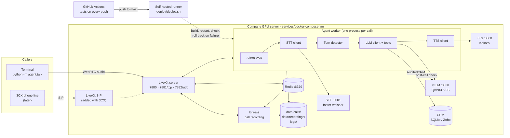

# Architecture

A self-hosted AI voice agent that phones real-estate leads, qualifies them, and updates the CRM.
Everything runs on the company GPU server. Nothing goes to a cloud API (self-hosting is cheaper at about 3,000 calls a day). English only.

## The picture



**Testing uses Ollama instead of vLLM.** Both speak the same OpenAI-compatible API, so only `LLM_BASE_URL` and
`LLM_MODEL` change in `.env` (`agent/config.py` works out which server it is from the URL). The two
differences are handled in code:
- **Thinking off:** vLLM gets `chat_template_kwargs`, Ollama gets `think: false` plus `/no_think` in the prompt.
- **Labels:** the call record's `served_by` says `vllm` or `ollama`.

## What each part does

| Part | Runs as | Job |
|---|---|---|
| **LiveKit server** | `livekit` container | Rooms and real-time audio (WebRTC). Every call is one room. The terminal client joins today; the 3CX line will join through LiveKit SIP later. |
| **Agent worker** | `agent` container, `agent/main.py` | LiveKit sends it each new room. It loads the lead from the CRM, then runs the voice pipeline: VAD → STT → turn detector → LLM with tools → TTS. Each call gets its own process. After the caller hangs up, the same process runs the post-call check (`agent/events.py`): the LLM checks the transcript (structured output), fills CRM fields the agent missed, enforces do-not-call, writes the summary note, collects the call's logs and recording, and saves the final call record. |
| **vLLM** | `vllm` container | Qwen3.5-9B behind an OpenAI-compatible API. Settings: thinking off for every request (`chat_template_kwargs.enable_thinking=false`), tool calls parsed by `qwen3_coder`, prefix caching so the long system prompt is computed once. |
| **STT** | `stt` container, `services/stt_server.py` | faster-whisper `large-v3-turbo` on the GPU, behind an OpenAI-compatible API. |
| **TTS** | `tts` container | Kokoro, behind an OpenAI-compatible API. |
| **CRM** | `crm/` | The agent only knows the `CRMClient` port (ports and adapters). SQLite for the demo, Zoho for production. `AuditedCRM` wraps whichever adapter is used and records every write as before → after. |
| **Redis** | `redis` container | How LiveKit and Egress (and later SIP) talk to each other. The agent doesn't use it. |
| **Egress** | `egress` container | Records both sides of each call to `data/recordings/<room>.ogg`. |
| **Deploy** | GitHub Actions + `deploy/deploy.sh` | Tests every push. A push to `main` is deployed by a runner on the server, checked with `agent.check`, and rolled back if the check fails. |

## One call, step by step

1. **A caller joins.**
   - `agent.talk` creates room `lead-L003-<time>` with `{"lead_id": "L003"}` and joins it with the mic.
   - Later, a 3CX call will join the same way through LiveKit SIP (`agent/dial.py` for outbound calls).
2. **LiveKit sends the room to the agent worker.**
   - The agent reads the lead, skips do-not-call leads, starts the recording, and greets the lead by name.
3. **Each turn:**
   1. VAD hears speech and STT writes it down.
   2. The turn detector decides the caller has finished.
   3. vLLM streams the reply. If the caller gives facts (budget, area, type, timeline) it first calls `update_lead`, which goes through `AuditedCRM` to the CRM.
   4. Kokoro speaks the reply.
4. **While the call runs, everything is logged as it happens** (see below).
5. **The call ends** (`end_call`, the caller hangs up, transfer, or error).
   - The agent writes `data/calls/<call_id>.raw.json`, so the call is saved whatever happens next.
6. **The post-call check** runs in the same process: extraction and CRM fill-in, then it links the recording, copies the call's log lines into the call folder, and replaces the raw file with `data/calls/<call_id>.json`.
   - If the process dies first, the raw file stays. `python -m agent.postcall` finishes it; the agent container runs this at every start.

## Logs: everything a call leaves behind

```
data/calls/<call_id>.json              the call record (the dashboard reads this)
data/calls/<call_id>/events.jsonl      timeline: speech, replies, states, tool calls, CRM changes, metrics, errors
data/calls/<call_id>/llm.jsonl         every LLM request (stage: call / post_call): messages sent, reply, tool calls, tokens, timings
data/calls/<call_id>/crm_changes.jsonl every CRM write during and after the call: before -> after
data/calls/<call_id>/agent.log         this call's log lines
data/calls/<call_id>/recording.ogg     both sides of the call (link to data/recordings/<room>.ogg)
logs/agent/<date>.jsonl                every agent log line (JSON, tagged with call_id)
logs/postcall/<date>.jsonl             agent.postcall runs (calls finished after a crash)
logs/stt/<date>.jsonl                  every transcription: audio seconds, processing time, text
docker compose logs <service>          LiveKit, vLLM, Egress, Redis, TTS (rotated: 10 × 50 MB each)
```

Every field is described in [call-record.md](call-record.md).

## Ports

| Port | Who needs it |
|---|---|
| 7880/tcp | callers: LiveKit API and signalling (`LIVEKIT_URL=ws://<server-ip>:7880`) |
| 7881/tcp, 7882/udp | callers: call audio (WebRTC) |
| 8000, 8001, 8880 | only the server itself (vLLM, STT, TTS). Open them to a laptop only to run `agent.check` from there. |
| 6379 | only the server (Redis is bound to 127.0.0.1) |

## Adding 3CX later

Nothing in the agent changes. A phone call is one more participant in the room.

1. Add the `livekit/sip` service to `services/docker-compose.yml`. It uses the same Redis, and needs a `sip.yaml` with the LiveKit keys and the SIP port (5060 and an RTP port range).
2. In 3CX, create a SIP trunk to the server. In LiveKit, create the matching outbound trunk (and an inbound trunk with a dispatch rule for incoming calls).
3. Put the trunk id in `.env` as `SIP_OUTBOUND_TRUNK_ID`, and the transfer target as `HUMAN_TRANSFER_TO`.
4. Run `python -m agent.dial --lead L003`. The agent rings the lead and starts talking once they answer.
   - Busy, no answer or declined is saved in the call record's `line` field.
   - Transfer to a person uses SIP REFER (`agent/telephony.py`).

## Why these choices

- **vLLM in production, Ollama for testing:**
  - vLLM's continuous batching and prefix caching serve many calls at once on one GPU, and it has proper tool-call and reasoning parsers for Qwen3.5.
  - Ollama runs on any laptop with no setup, which makes it good for testing behaviour.
  - Both have an OpenAI-compatible API, so the agent code doesn't care which one it talks to.
- **No Celery:**
  - Each call already has its own process, so post-call work (1–2 s) runs in parallel without a queue.
  - A crash or redeploy doesn't lose a call: the raw record is saved first and finished at the next start, and a deploy lets running calls end before it stops the old agent.
  - Celery would add a worker, a broker dependency for the agent, and more to deploy and watch, for no gain at this size. Add it back only if post-call work grows to minutes per call.
- **Redis only for LiveKit:** Egress (recording) and SIP (3CX) need it to talk to the LiveKit server.
- **Logs written as they happen:**
  - The JSONL files are appended line by line during the call, so a crash still leaves the full trail up to that point.
  - The final record is written in one atomic step, so the dashboard never reads half a file.
